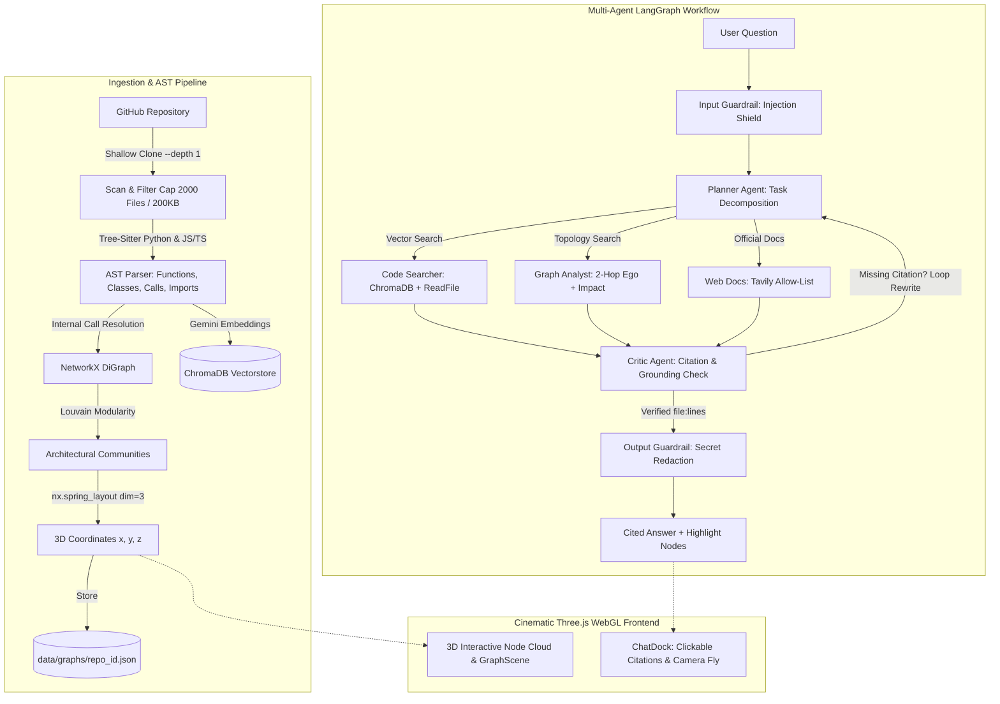

# RepoLens

> **Autonomous GitHub Code Knowledge Graph & Multi-Agent Reasoning Agent**  
> *Transform complex codebases into 3D GraphRAG knowledge graphs with cited, verified answers.*

---

## 1. System Architecture

RepoLens couples an AST-based Code Knowledge Graph (GraphRAG) with a multi-agent LangGraph reasoning engine and a cinematic Three.js WebGL visualization.



---

## 2. GraphRAG & Code Knowledge Graph

RepoLens does not rely solely on flat semantic embeddings. It constructs a **hierarchical code knowledge graph**:

1. **AST Extraction**: Tree-sitter extracts `File`, `Module`, `Class`, `Function`, and `Import` symbols with exact `start_line` and `end_line`.
2. **Call Graph Resolution**: Resolves internal calls across files while filtering unresolved third-party externalities.
3. **Louvain Community Partitioning**: Detects tightly coupled functional modules, naming clusters through LLM/heuristic summarization.
4. **3D Spring Layout**: Projects nodes into continuous 3D coordinate space `(x, y, z) \in [0..1]` using `nx.spring_layout` (seed 42), rendering directly in Three.js.
5. **Impact Blast Radius Analysis**:
   - **Upstream Blast Radius**: `nx.ancestors` over `calls` and `imports` identifies all components that break if a symbol changes.
   - **Downstream Dependencies**: `nx.descendants` identifies all underlying dependencies, ranked by shortest path distance.

---

## 3. Security Guardrails

| Guardrail | Implementation | Purpose |
| :--- | :--- | :--- |
| **Input Shield** | `guardrails/input.py` | Detects prompt injection patterns and refuses execution/modification requests. |
| **Repository Sandbox** | `guardrails/repo.py` | Enforces HTTPS `github.com/<owner>/<repo>` format; caps 2000 files and 200KB; disables git hooks and submodules. |
| **Secret Redaction** | `guardrails/secrets.py` | Regex scrubbing of AWS, GitHub, Google API, JWT, and PEM private keys prior to indexing and API responses. |
| **Web Content Guard** | `guardrails/web.py` | Restricts search to `ALLOWED_DOMAINS`; strips instruction-like lines; wraps external text in `<untrusted_content>`. |
| **Output Citations** | `guardrails/output.py` | Enforces that every technical claim references exact `path:start_line-end_line` citations. |
| **Execution Budgets** | `guardrails/budgets.py` | Enforces caps on max agent steps (12), searches (5), session tokens (20,000), and request timeouts (60s). |

---

## 4. Frontend WebGL & Motion Specification

Built strictly adhering to the **Pale Sage, Ivory, and Muted Forest Sage** design system:

- **Tokens (`tokens.css`)**: 3-tier CSS variables (`raw -> role -> usage`). Zero off-palette hues.
- **Motion Engine (`src/lib/`)**:
  - `ticker.js`: Shared RAF clock with smoothed FPS calculation and visibility auto-pause.
  - `spring.js`: Critically damped mass-spring-damper physics solver.
  - `scrollTrigger.js`: Viewport intersection progress and velocity calculation.
  - `stack.js`: Sticky card stacking with `0.9` scale and `55%` opacity recession.
  - `lenis.js`: Lenis smooth scrolling wired to ticker; respects `prefers-reduced-motion`.
- **Hero Scene (`src/three/HeroScene.js`)**:
  - Procedural 4-sine contour canvas backdrop (`ContourCanvas.js`).
  - 3D Point Cloud instanced from graph coordinates with cursor parallax drift.
  - "Code Shell": Wireframe + solid icosahedron with dual orbital rings.
  - Crown-to-chin burn-away dissolution shader with 3.1s pulse wave.
- **Topology Section (`src/three/GraphSoFar.jsx`)**:
  - `ChequerDissolve.js`: Alternating diagonal chequerboard seam transition.
  - `HalftoneMap.js`: 2D density halftone grid with crawling dashed coordinate axes.
  - `TraversalTrace.js`: 6.0s looping traversal along top-degree hubs with corner braking.
- **3D Graph Explorer (`src/three/GraphScene.js`)**:
  - Instanced node geometries by type (File = sphere, Class = octahedron, Function = sphere, Module = ring, Import = dot).
  - Colored `LineSegments` relations (`contains`, `calls`, `imports`, `inherits`).
  - OrbitControls with damping, raycaster hover tooltip, and node inspection drawer.
  - `ChatDock.jsx`: Live LangGraph queries with clickable `file:line` chips that focus 3D camera.

---

## 5. Getting Started

### Prerequisites
- Python 3.11+
- Node.js 18+ (tested on Node v24)
- Google Gemini API Key

### Backend Setup
```bash
cd backend
python -m venv venv
venv\Scripts\activate     # On Windows
# source venv/bin/activate # On Unix

pip install -r requirements.txt
uvicorn app.main:app --port 8000 --reload
```
Verify backend health:
```bash
curl http://localhost:8000/health
# {"status":"ok","version":"1.0.0"}
```

### Frontend Setup
```bash
cd frontend
npm install
npm run dev
```
Open [http://localhost:5173](http://localhost:5173) in your browser.

### Running Backend Tests
```bash
cd backend
pytest -v
```

---

## 6. License
MIT License. Built for deep codebase intelligence.
